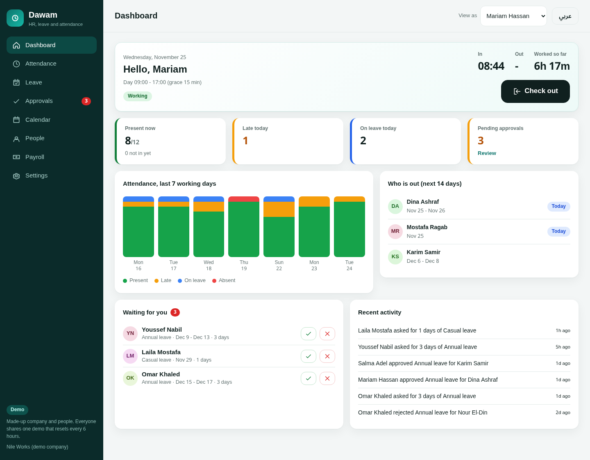
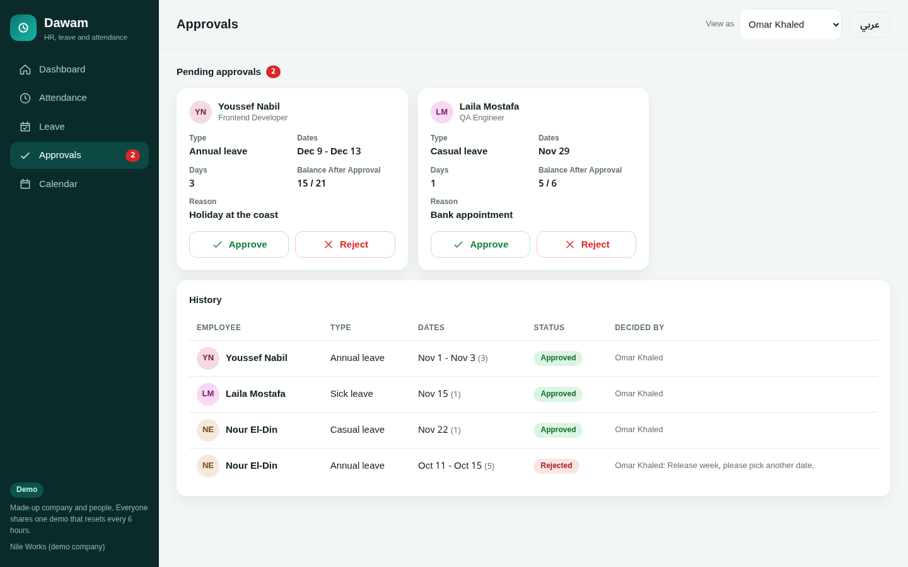
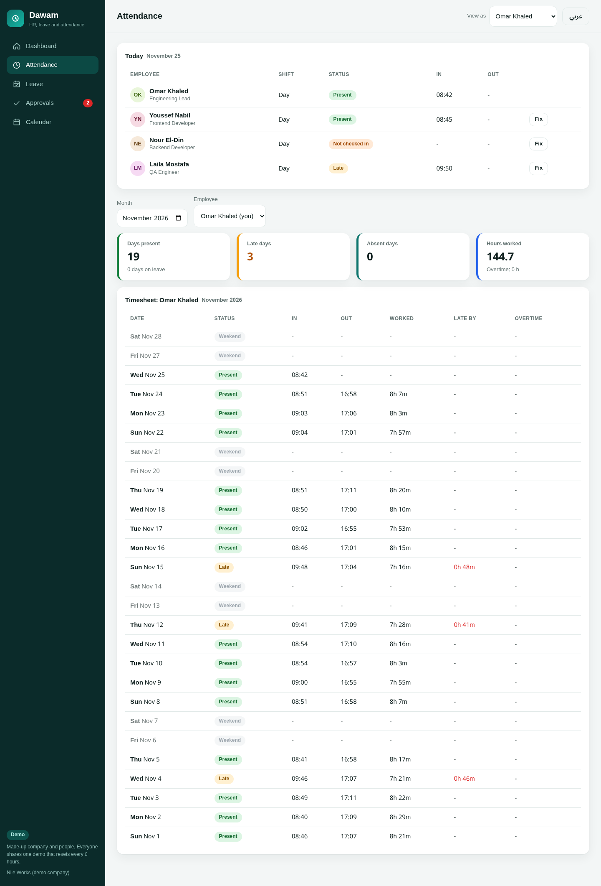
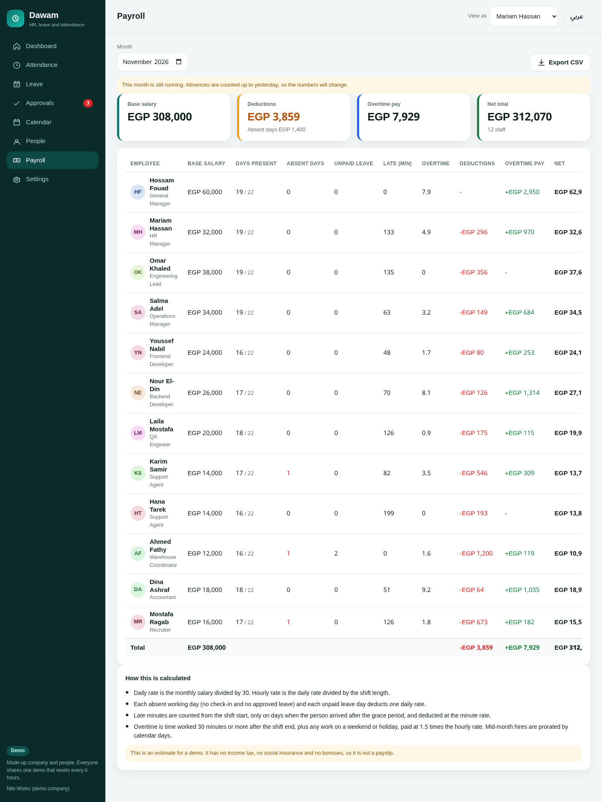
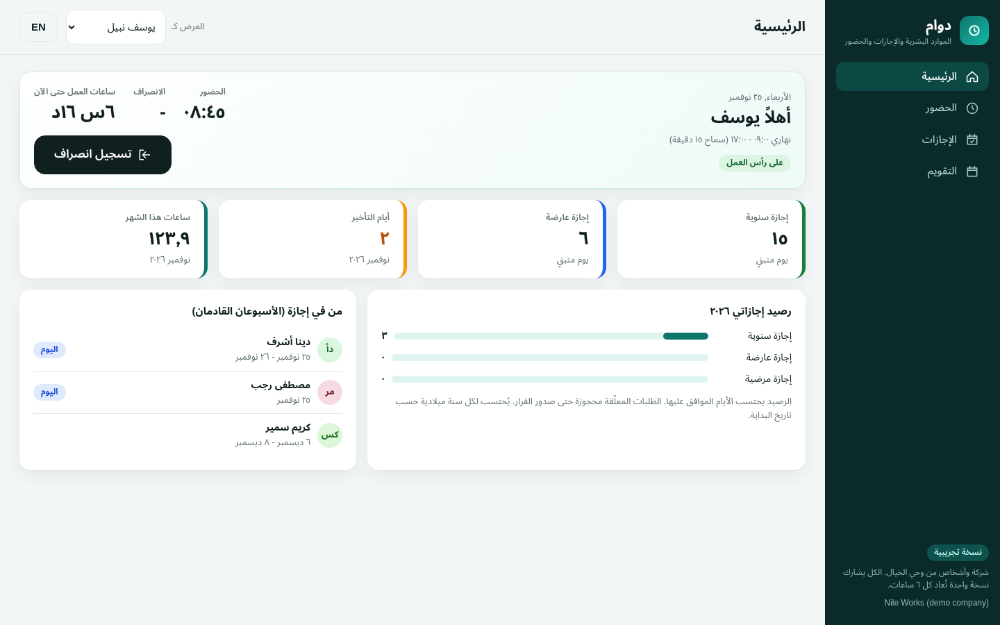
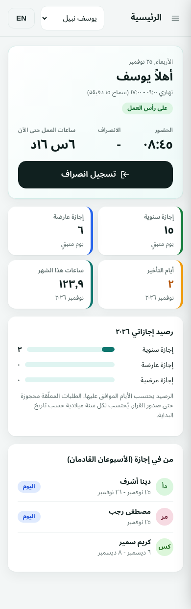
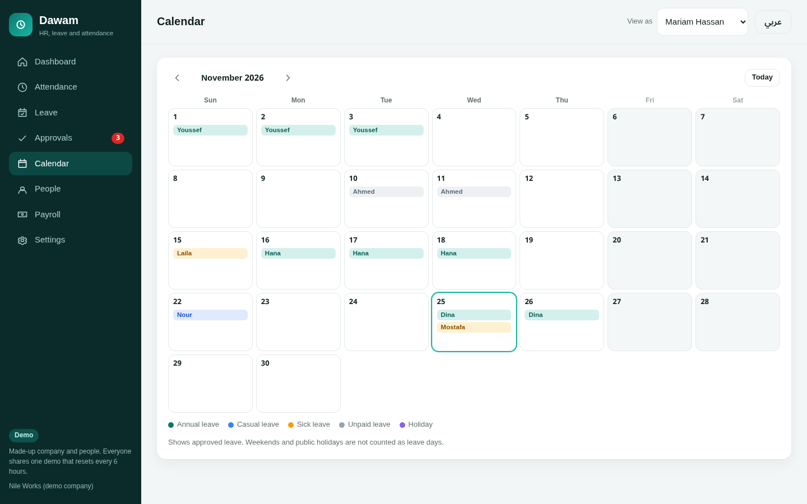

# Dawam (دوام)

A bilingual (English and Arabic, right to left) HR, leave and attendance system for small companies: employee records, leave requests with approvals, check-in and check-out against shifts, offline check-in, a leave calendar, a monthly payroll estimate, and three roles (HR admin, manager, employee). Hosted as an interactive demo on Vercel.

**Live demo:** https://dawam-hr.vercel.app (made-up company, resets every 6 hours)



| Approvals | Timesheet | Payroll |
|---|---|---|
|  |  |  |

| Arabic (RTL) | Phone, Arabic | Leave calendar |
|---|---|---|
|  |  |  |

## What it does

- **Roles.** HR admin sees everyone and payroll. A manager sees their own team and decides their team's leave. An employee sees only their own records. The server enforces this on every call (salaries, leave reasons and payroll are never sent to people who may not see them).
- **Check-in and check-out.** One button on the dashboard. Each person has a shift (start, end, grace minutes). Arriving after the grace period counts as late; work 30 minutes or more past the shift end, or any work on a weekend or holiday, counts as overtime. Times are taken in the company time zone (Cairo in the demo) on the server.
- **Works offline.** If the connection drops, check-in and check-out are saved on the device with the real moment they happened and sent when the connection returns. The server accepts a saved moment only if it is not in the future and not older than 36 hours. The app shell is cached by a service worker and the last loaded data stays readable, with a clear "you are offline" banner.
- **Leave.** Annual, casual, sick (each with a yearly balance) and unpaid. Working days are counted without weekends (Friday and Saturday) and public holidays. Pending requests reserve balance. Overlaps, empty ranges, past dates and overspending are rejected. A manager or admin approves or rejects (a reason is required to reject); nobody can approve their own request. Employees can cancel pending or future leave.
- **Corrections.** A manager or admin can fix a day's check-in and check-out for someone else. Edited days are marked and logged. Nobody can edit their own record.
- **Calendar.** Who is out, by day, with holidays and weekends. Other people's reasons are hidden.
- **People and settings (HR admin).** Add and edit employees (role, manager, shift, salary, leave entitlements), deactivate people, edit shifts, add holidays. Guards against manager loops and removing the last admin.
- **Payroll estimate (HR admin).** For any month: base salary prorated for mid-month hires, deductions for absent days, unpaid leave and late minutes, overtime pay at 1.5x, net per person, totals, CSV export. The rules are written on the page.
- **Arabic and English.** One switch flips language, direction, digits, dates and currency through `Intl`. CSS uses logical properties, so RTL needs no second stylesheet.
- **Phone layout.** The sidebar becomes a drawer, timesheet rows turn into cards.

## How it is built

- Frontend: plain HTML, CSS and ES modules. No framework, no build step. Every rendered value goes through an `esc()` helper.
- Backend: one serverless function (`api/data.js`) that applies validated operations (`leave.request`, `leave.decide`, `att.in`, `att.set`, `emp.save`, ...) for a given actor and returns only the view that actor may see.
- Business rules live in `api/_logic.js` as pure functions (calendar rules, balances, attendance status, payroll, permissions, seed data). The server recalculates everything and never trusts totals or statuses sent by the browser.
- Storage: Vercel Blob. Each save writes a new versioned file and deletes the old one.

```
public/    index.html, app.js, i18n.js, styles.css, sw.js
api/       data.js (HTTP + storage), _logic.js (rules, views, seed data)
test/      logic.test.mjs
docs/      screenshots
```

## Run it

```bash
npm install
npm test                 # business-rule tests
npm run dev              # local server on :3100, in-memory data, no Vercel account needed
```

To deploy: `vercel deploy`, then create a Blob store so `BLOB_READ_WRITE_TOKEN` is set.

## Checked

`npm test` runs 15 groups of rule tests: weekends and holidays, leave validation, balance reservation, overlaps, who may approve or cancel, check-in and out, offline timestamps (future, stale, malformed), late, grace and overtime, manual corrections, payroll arithmetic including proration and non-negative pay, employee validation (manager loops, last admin), and what each role is allowed to see.

The running app was also driven in a real Chrome browser: an offline check-in that is queued and then synced when the connection returns, an online check-out, a leave request with the live working-day count, an overlap error shown in the form, a manager rejecting (with reason) and approving, a different team's manager and an employee not seeing approvals, an admin adding a person and a holiday, and an employee being unable to open People. Arabic RTL and a 390 px phone width were checked on screenshots.

## Honest limits

- **No login.** It is a public demo: the "View as" menu switches between made-up people. The server checks what each role may do, but it does not verify who is calling. A real deployment needs authentication (for example sessions or SSO) in front of `api/data.js`.
- **Payroll is an estimate.** No income tax, no social insurance, no bonuses or loans, and no payslip PDFs. Absences are counted up to yesterday in the current month.
- **Shifts do not cross midnight**, and there is one check-in and one check-out per day.
- **Saving is last write wins.** Two people saving at the same instant can overwrite each other. Fine for a demo, not for production; use a database with transactions.
- **Leave is counted per calendar year by the start date**, and a request cannot span two years. There is no carry-over or accrual.
- **Notifications** (email or push for new requests and decisions) are not built.
- The company, people, holidays and numbers are made up.
